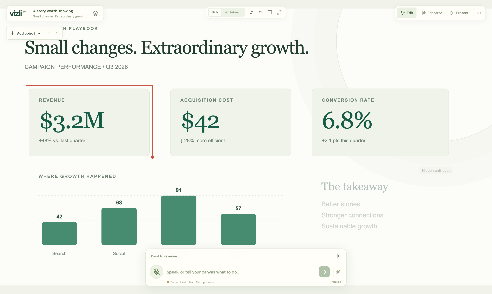
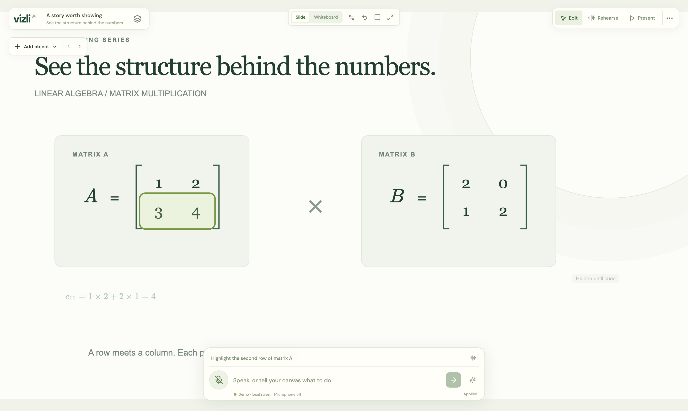
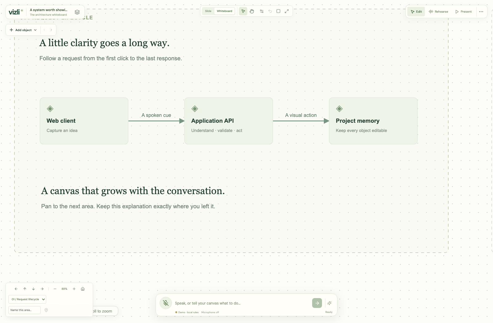

<p align="center">
  
</p>

<p align="center">
  <strong>Visual explanations that follow your voice.</strong><br>
  Speak, and the canvas points, highlights, draws and edits. Editable slides and infinite whiteboards,<br>
  powered by <strong>NVIDIA Nemotron</strong> on <strong>Nebius Token Factory</strong>.
</p>

<p align="center">
  <a href="LICENSE"></a>
  <a href="docs/HACKATHON.md"></a>
  
  
  
  
</p>

<p align="center">
  <a href="#run-locally">Run locally</a> ·
  <a href="#how-vizli-uses-nvidia-nemotron-and-nebius-token-factory">How it uses Nemotron</a> ·
  <a href="#narrate-a-matrix-multiplication-lesson">Narrated lesson</a> ·
  <a href="docs/STATUS.md">Status</a> ·
  <a href="docs/STATUS-PENDING.md">Pending work</a> ·
  <a href="docs/HACKATHON.md">Hackathon</a>
</p>

<p align="center">
  
</p>

## What it does

Vizli is a presentation studio for people who explain things out loud: teachers, presenters, e-learning authors and anyone thinking at a whiteboard. Every scene is editable JSON with stable object and part IDs, so a spoken sentence can land on exactly the right bar, matrix row or diagram node.

| Say it | Vizli does it |
| --- | --- |
| “Point to revenue” · “Highlight the second row of matrix A” | A red pointer or highlight lands on that exact object or part. |
| “Reveal the takeaway” · “Animate matrix A with draw effect” | Prepared content appears on cue; motion presets play and can be cancelled. |
| “Make matrix A 3 by 2” · “Change Revenue to $4.5M” | The object is edited in place, atomically, with one undo step. |
| “Draw a software architecture” · “Let's go right” · “Go to Start” | Nemotron plans editable objects onto the whiteboard; the camera travels and returns. |
| “An apple on the x axis” | A sourced Wikimedia image is placed on the chart axis with attribution. |
| “A is three by two and B is two by three…” | A narrated matrix-multiplication lesson draws itself step by step. |

<table>
  <tr>
    <td width="50%"></td>
    <td width="50%"></td>
  </tr>
  <tr>
    <td align="center"><sub>Addressable matrices, equations and plugin parts</sub></td>
    <td align="center"><sub>Infinite whiteboard with named areas and a persistent camera</sub></td>
  </tr>
</table>

Listening and animation are separate lifecycles: the microphone keeps working while a lesson plays, ambiguous cues skip instead of guessing, and every action is fenced by the scene revision it was made for. Without credentials the app runs in a clearly labelled demo mode that performs no model inference.

## How Vizli uses NVIDIA Nemotron and Nebius Token Factory

Built for the Nebius x NVIDIA Global AI Hackathon, **Best Apps and Agents** track. Project work began in October 2026, inside the submission period.

- **Core reasoning: NVIDIA Nemotron 3 Super (`nvidia/nemotron-3-super-120b-a12b`) on Nebius Token Factory.** Every live spoken or typed instruction is sent to the Token Factory chat-completions API (`apps/server/src/resolver.ts`). Nemotron receives the current scene's objects, semantic parts and plugin capabilities and returns a strict JSON-Schema action: point, highlight, reveal, animate, navigate, move, add a component, retrieve an image, or edit an existing object. The server validates the proposal against the live scene revision before anything renders. Thinking is switched off for these fast calls through `chat_template_kwargs.enable_thinking=false`.
- **Scene and illustration planning: the same Nemotron model through Token Factory** (`apps/server/src/generate.ts`). "Create from an idea" and spoken "Draw a software architecture" requests ask Nemotron for a complete validated scene of editable objects and connections, which is appended to the whiteboard.
- **Speech: NVIDIA-hosted Nemotron ASR** (`apps/server/src/speech.ts`) streams microphone PCM over TLS gRPC and returns partial and final transcripts that feed the Nemotron interpreter above.
- **What is deterministic:** Wikimedia image search, whiteboard navigation phrases and the matrix-multiplication lesson planner are rule-based and are labelled as such. Without credentials the app runs in a clearly labelled demo mode that performs no model inference.

Live verification of the Token Factory path (scene generation, cue interpretation and hosted ASR → Nemotron → visual action) is recorded in [docs/STATUS.md](docs/STATUS.md); `pnpm check:hackathon` audits the configuration locally.

## Run locally

Requirements: Node.js 24 or newer and pnpm 12.

```sh
pnpm install
pnpm dev
```

Open **http://127.0.0.1:5173**. The API listens on port 3001 by default; set `PORT` in the root `.env` if that port is taken by another local service, and the Vite proxy and default allowed origins follow it. The app works without API credentials in explicitly labelled demo mode. Type a cue or use the example cues to exercise the same visual action pipeline.

The workspace is a full-screen canvas with floating controls. Open the stacked-scenes button beside the project title to navigate scenes; use the top-right menu for project actions. Voice and typing stay available in the bottom dock.

Try the marketing metrics, matrix lesson, and architecture diagram. Click objects to edit them. Switch to Rehearse to bind a phrase to a selected object; Present hides editing controls and waits for cues.

Use the visible **Slide / Whiteboard** switch to turn the current scene into an expanding workspace without losing its objects. Whiteboard enables the **Hand** tool: drag anywhere to pan, including over objects. Choose **Select** to move/edit objects, or hold Space while dragging for temporary panning. **New whiteboard** creates a separate blank scene. Try **“Draw a software architecture”**, **“Let's go right”**, **“Draw a matrix lesson”**, then **“Go to Start”**. Earlier objects stay in place. You can name areas, pan the background, scroll to pan, and Ctrl/⌘-scroll to zoom. **“Move Web client right”** changes an object's position; **“Highlight Web client”** brings it into view. Drawing uses labelled example templates without Nebius credentials and the configured Nemotron planner when live. Boards currently support up to 300 objects.

On the marketing slide, type **“An apple on the x axis.”** Vizli searches Wikimedia Commons live and inserts a sourced, editable image attached to the chart's x-axis. This works without provider keys (internet required). Moving the chart keeps the attachment; dragging the image detaches it. Source attribution and license appear in the inspector. The current command requires one visible chart; it does not yet create axes or search arbitrary websites.

## Amend objects by voice

Existing objects can be edited with spoken or typed instructions. Try **“Make matrix A 3 by 2”**, **“Set row 3 column 2 of matrix A to 9”**, or **“Change Revenue to $4.5M.”** You can also request label/text/color changes, explicit dimensions, and individual chart values. Name the object clearly; ambiguous edits are skipped. Each completed edit is atomic and undoable, and matrix resizing preserves overlapping values while filling new cells with zero. Symbolic calculation and automatic derivation updates remain separate work.

## Live speech and AI

Copy `.env.example` to `.env` at the repository root. Set:

- `NVIDIA_API_KEY` to enable NVIDIA-hosted Nemotron ASR microphone transcription. Obtain a key with access from [NVIDIA's model API page](https://build.nvidia.com/nvidia/nemotron-asr-streaming/api). The hosted endpoint/function ID defaults are in `.env.example`.
- `NEBIUS_API_KEY` and `NEBIUS_MODEL` to enable Nemotron interpretation through Nebius Token Factory. The selected initial model is `nvidia/nemotron-3-super-120b-a12b` (Nemotron 3 Super), populated in `.env.example`; verify it is enabled for your account.
- Optionally `NEBIUS_PLANNING_MODEL` for a larger model used by **Create from an idea**; otherwise it uses `NEBIUS_MODEL`.

Restart the server after changing configuration. Keys remain on the server. Browser microphone permission is required and microphone capture needs localhost or HTTPS.

Demo mode uses a deterministic resolver, not an AI model. Live provider latency and accuracy must be measured with configured accounts; offline tests cannot establish them.

For the hackathon, the selected path is **NVIDIA-hosted Nemotron ASR + Nemotron reasoning on Nebius Token Factory**, with guest entry and no paid TTS. The backend streams PCM audio to NVIDIA over TLS gRPC; it does not host a speech GPU. Mandatory signup is deferred. Server limits are configured through `MAX_CONCURRENT_VOICE_SESSIONS`, `MAX_VOICE_SECONDS_PER_SESSION`, `MAX_LLM_REQUESTS_PER_HOUR`, and `MAX_CONCURRENT_LLM_REQUESTS`; see `.env.example` and `docs/BACKEND.md`. These are lightweight single-process safeguards, not a durable billing system or a guaranteed spend cap.

**Hackathon readiness:** NVIDIA-hosted speech alone does not satisfy the Nebius requirement. Configure `NEBIUS_API_KEY` and an actual NVIDIA Nemotron `NEBIUS_MODEL` on Token Factory, then verify meaningful live agent calls. The rule-based local demo is not evidence of Nebius execution. See [docs/HACKATHON.md](docs/HACKATHON.md) for the required validation and remaining submission work.

Hosting direction: Vercel frontend, Railway backend/Postgres, and Cloudflare R2 assets. Railway/Postgres/R2 integration and external deployment are still pending; the existing Supabase feature below is optional and is not required for the demo.

## Optional cloud library

The Cloud button supports Supabase email-link sign-in and explicit project save/load. Follow [docs/CLOUD.md](docs/CLOUD.md) to configure the public browser URL/key and apply the owner-scoped database migration. Local editing works without a cloud account. Uploaded images are embedded in project JSON; retrieved web images retain external URLs and provenance.

## Commands

```sh
pnpm typecheck
pnpm check:hackathon
pnpm build
pnpm test
pnpm exec playwright install chromium
pnpm test:e2e
pnpm start
```

`pnpm start` runs the API and serves the built web application after `pnpm build`. Development uses Vite with an API/WebSocket proxy.

`pnpm check:hackathon` checks server configuration for the required Nebius/NVIDIA model path without spending credits or printing secrets. Missing keys cause a nonzero exit; the check does not certify live provider access or submission eligibility.

## Architecture

- React + TypeScript + Vite for the studio.
- SVG/HTML for addressable slides, matrices, charts, and images.
- React Flow for editable architecture diagrams; ELK for layout.
- XState for explicit interaction/session transitions.
- Fastify + WebSockets for speech and validated actions.
- NVIDIA-hosted Nemotron ASR for live transcription and Nemotron on Nebius Token Factory for interpretation.
- Validated project JSON and local persistence, with optional Supabase Auth/Postgres cloud save/load.

The project targets the Nebius x NVIDIA hackathon. Runtime Nemotron inference through Token Factory is the intended qualifying integration. A demo-only run does not demonstrate that integration.

## Handoff and current limitations

Start with [docs/STATUS.md](docs/STATUS.md) for verified progress and outstanding work. [PLAN.md](PLAN.md) records product decisions. [docs/DESIGN.md](docs/DESIGN.md) describes implementation boundaries. [BUILD_CONTRACT.md](BUILD_CONTRACT.md) records cross-component interfaces.

This is initially a local single-user application. Supabase cloud rows have owner-scoped access policies; the local API/session server is still single-user and must gain authentication before public deployment. No deployment, account provisioning, or hackathon submission has been performed.

## Domain libraries and motion

Open **Add object** for **Mathematics**, **AWS architecture**, or **UML diagrams**. Insert matrices/equations, representative AWS service shapes, or editable UML classes. Select an object to choose **Target part** and highlight an internal member, or select a **Motion preset** and preview it. Try “Animate matrix A with draw effect” or “Highlight methods of Customer”. Draw progressively reveals content; it is not handwritten font tracing. AWS artwork is an original representative palette, not the official full icon catalogue.

The implementation separates shared plugin contracts, renderer modules and motion adapters. Existing projects remain compatible. Read [docs/PLUGINS.md](docs/PLUGINS.md) for extension patterns, target IDs, supported scope and file ownership.

## Narrate a matrix multiplication lesson

On a whiteboard, say or type:

1. “Today we'll learn about matrix multiplication.”
2. “There are two matrices A and B. A is three by two and B is two by three.”
3. “Point to the first row of A.”
4. “Highlight the second row of A in blue.”
5. “Now let's scroll down to see the multiplication.”
6. “The rows of A can be multiplied with the columns of B.”

Matrices draw progressively; the pointer traces an outline, highlights fade in, and the view pans smoothly. The lesson fills nine output cells one at a time while showing each dot product. Dimensions alone use symbolic entries. Edit the source values to numbers for numeric multiplication. Pause/resume/skip/cancel controls appear while a sequence plays. Editing sources cancels playback and hides stale derived results.

The generic sequence schema and player are reusable across domain plugins; the first narrated lesson planner is matrix multiplication. See [docs/NARRATED_LESSONS.md](docs/NARRATED_LESSONS.md) for architecture, validation, evidence and limits.

## License

Vizli is released under the [Apache License 2.0](LICENSE); see [NOTICE](NOTICE) for attribution and third-party notices. Vendored NVIDIA Riva protocol files keep their MIT/Apache-2.0 licenses.

JSON project import/export is the editable interchange format. Arbitrary PowerPoint/PDF reconstruction, symbolic mathematics, and automatic editable decomposition of raster images are separate work.

Browser regression tests (`pnpm test:e2e`) launch isolated demo servers on ports 5174/3002 with temporary storage and paid providers disabled; they do not reuse the live development app.
