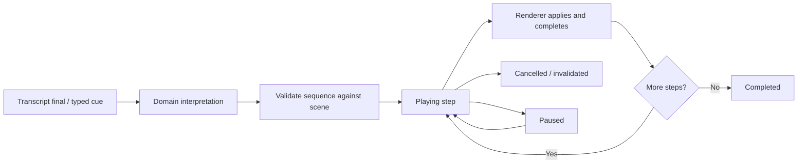

# Narrated presentations and lesson execution

Status: implemented and verified locally, 10 October 2026.

## Acceptance story

A teacher begins on a whiteboard and says “Today we'll learn about matrix multiplication.” As the teacher introduces matrix A as 3×2 and B as 2×3, the matrices are drawn progressively. Since dimensions do not specify values, entries are symbolic, never invented numerical data. Attention cues trace the requested row in red; an explicit highlight can specify a supported colour. A request to scroll down moves the view smoothly. A row-times-column explanation produces correct dot-product steps, one at a time. If matrices contain numeric values, the same domain planner computes numeric products.

This is a narrated interaction, not a prerecorded video or a one-off front-end demo script. Transcript and typed input use the same interpretation pipeline. Supported natural-language patterns have deterministic domain grounding; general interpretation continues to use Nemotron on Nebius. Speech remains active while a visual sequence plays.

## Segregation

The domain planner owns meaning and arithmetic. It produces a bounded, serializable sequence of generic presentation commands. It does not call browser APIs, animate DOM, or execute model-generated code.

The shared presentation contract owns valid steps, stable target IDs, source dependencies and scene mutations. Validation simulates the plan against the current scene before playback; referencing missing targets or exceeding object/step bounds is rejected.

The browser sequence controller owns ordering, playback state and cancellation. Renderers acknowledge draw/attention completion before the next step. Camera and motion adapters own visual interpolation. Plugins supply semantic parts and optional domain planners, not a separate playback engine.

The editor owns history and persistence. A new user edit, scene change, undo or replacement plan must not allow stale queued work to alter the new scene. Source matrix changes must invalidate derived calculations. Completed steps can remain as editable objects, and cancellation must never fabricate a completed acknowledgement.

## State transitions

Partial speech may guide attention, but never commits newly introduced objects or mathematical steps. Declarations require "matrix a …" or "a is/has …"; the article in "insert a 3 by 3 table" is not a declaration. A revised interim transcript retracts only speculative attention and does not cancel a running sequence. Final speech can arrive in separate clauses: A and B declarations must survive that segmentation. Repeating a cue should not duplicate lesson objects.

## Reuse beyond maths

A UML planner could introduce a class, reveal methods one by one and highlight a method. An architecture planner could introduce services, pan to another area and trace a request path. Both should emit the same insertion, attention, camera, reveal and wait steps. Only object schemas, semantic target enumeration and domain planning differ.

## Limits to communicate

Writing uses progressive glyph/content reveal and outline tracing, not inferred handwriting strokes. The maths implementation supports a bounded matrix multiplication lesson, not a general computer algebra system. Voice recognition can still mishear words; preserve the transcript and allow typed corrections. New domain lesson planners require explicit implementation even though they reuse playback.

## Verification plan

- Shared/server: dimensions and ASR variants, split finals, idempotence, symbolic and numeric dot products, invalid dimensions, colour safety, final-only mutation and stale plan rejection.
- Browser: spoken-text-equivalent cues through the real isolated demo pipeline, progressive insertion, exact row/column targets, coloured highlighting, smooth camera pan, one-by-one calculations, cancellation and persistence.
- Renderer: no first-frame flash, no camera snapping during voice navigation, reduced-motion support and correct completion/cancellation callbacks.
- Live smoke: hosted ASR for representative phrases if available, without treating deterministic/browser checks as evidence of live model accuracy.

## Implementation contract

`PresentationSequence` contains at most 60 uniquely identified steps, a domain ID, and optional source IDs/signature. Steps are insert, update, attention, camera, reveal, wait and context. Each has a strict schema; durations, deltas, object counts and targets are bounded. `applyPresentationStep` is the shared mutation reducer; `validatePresentationSequence` simulates all steps before execution.

`DomainPlanner.plan(text, scene)` returns a validated sequence, an explicit skip, or no match. The domain registry runs trusted planners; `domains/math.ts` owns declaration parsing and arithmetic. Its introduction selects an empty area below nearby existing objects instead of clearing the board. The lesson anchor survives split A/B declarations and camera moves. Known utterances compile deterministically; general cues retain the existing Nebius interpreter. These deterministic lesson commands are not themselves evidence of a live Nemotron call.

`usePresentationPlayback` uses XState with idle, playing, paused, completed and cancelled states. It validates the starting scene, applies each step, then awaits renderer completion. The whole sequence receives one undo entry. Pause, resume, skip and cancel are exposed in compact controls. Missing targets, stalled renderers, manual edits, undo, scene switches and disconnects cancel playback rather than fabricate success. Wait steps are local and pause-aware.

`PresentationLayer` owns multi-target attention and insert/update playback; camera interpolation stays in the camera adapter. Semantic group targets work identically for matrix columns and other authored groups. A red laser head traces the perimeter of a requested target. Highlights fade in and accept a bounded colour palette. Reduced-motion preference reduces animation while preserving ordered steps.

Server self-commit acknowledgement uses a sequence ID plus prevalidated intermediate scene snapshots. The server does not trust a sequence ID alone to bypass revision validation. Browser playback also tracks its exact expected scene; user changes cancel remaining work.

## Mathematical representation

Dimension-only matrices contain symbolic identifiers (`a11`, `b11`) rendered with subscripts. Numeric cells remain numbers. Products use correct row-by-column dot products. For symbolic results, compact `c11` cells refer to full stored `math.expressions[row][column]`; the current expression is shown in a KaTeX equation and each result cell retains its expression as a tooltip. Numeric results show their computed values directly.

The example has nine output cells. Each step emphasizes A's row and B's column, draws the current formula, and fills the next result cell. The result is persisted and editable; the current formula panel is reused rather than retaining nine separate equation panels. Generated outputs carry generic source signatures. Editing or removing a source hides stale derived outputs and cancels pending playback; undo restores the prior document. Regeneration is explicit.

Limits: matrices up to 30×30 can be declared, but a narrated multiplication is capped at 16 output cells and 8 terms per dot product. This bounds visual duration and expression size. Introductory A/B declarations reject conflicting existing matrices rather than replacing them. Repeating a completed lesson instruction does not duplicate content; attention requests remain replayable.

## Demo script

Start a new whiteboard, or use the current whiteboard (existing content is preserved in its original area):

1. “Today we'll learn about matrix multiplication.”
2. “There are two matrices A and B. A is three by two and B is two by three.”
3. “Point to the first row of A.”
4. “Highlight the second row of A in blue.”
5. “Now let's scroll down to see the multiplication.”
6. “The rows of A can be multiplied with the columns of B.”

Allow each declaration to finish drawing before the next cue during a demonstration. A and B can also be introduced in separate utterances. Typing these phrases uses the same domain pipeline. If numeric examples are preferred, replace source matrix values through the inspector before step 6.

## Verification evidence

- Full browser regression suite: 23 passed. The teacher acceptance test uses the real isolated demo server and six typed equivalents of the spoken cues, checks exact rows/colours, camera motion, all nine symbolic result cells and expressions, idempotence and reload. Another test emits an AWS sequence through the same renderer/player and verifies pause, manual-edit cancellation and grouped undo.
- Hosted NVIDIA ASR smoke: six locally synthesized speech clips streamed as 16 kHz PCM through the actual WebSocket/NVIDIA service. Six final transcripts produced six sequences, zero errors, A3×2, B2×3, AB3×3 and nine stored expressions. The harness applies the shared reducer and acknowledges sequences; browser animation is verified separately. This is not evidence of recognition accuracy for every accent or environment.
- The hosted transcript merged “A and B. A is” into “A and Ba is”. A narrowly scoped A/B declaration boundary repair is covered by a regression test; the original recording then passed. No arbitrary word splitting is performed.
- Canvas CUA review used an isolated fixture produced by the real domain planner. Matrix rows/columns, simultaneous highlights, symbolic subscripts, current equation and result matrix were checked. Layout was compacted to keep the result above the voice dock at a typical desktop viewport. Temporary fixtures were removed.
- Live smoke artifacts remain ignored under `.data/verification/`: `check-narrated-lesson.mjs` and `lesson-*.wav`. They contain synthetic demo speech, no credentials and no user project writes.

The browser's microphone capture path was already implemented; this milestone verified hosted transcription using synthetic audio, not a fresh recording of the user's microphone. General Nemotron interpretation remains configured, but these known lesson commands use the deterministic domain planner.
