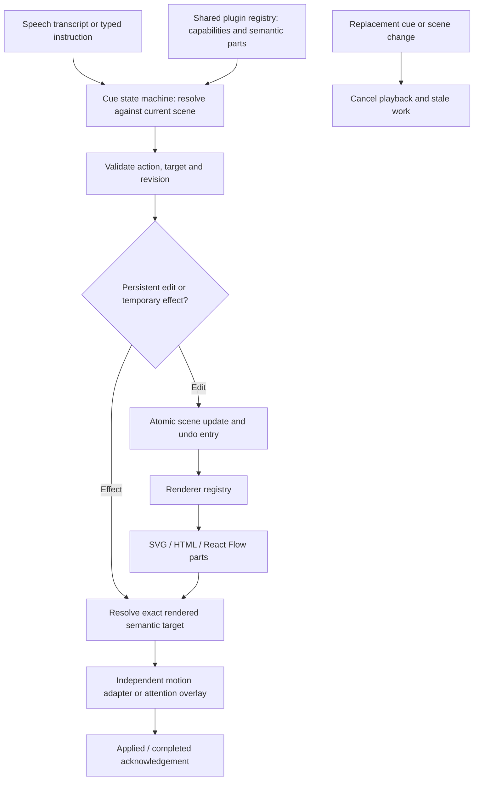

# Domain plugins and motion

Status: plugin system implemented locally on 10 October 2026; official AWS assets and bounded request-flow planner added 12 October 2026. See STATUS.md for current verification evidence and remaining scope.

## Design

A scene is a saved semantic document. A plugin describes an object's domain meaning and available internal parts. The renderer converts that document to SVG/HTML/React Flow. Motion controls temporary playback. Camera, selection, persistence, undo, speech capture and cue state machines remain outside plugins.

The first registry is a trusted, bundled TypeScript registry, not a marketplace or runtime code loader. Saved projects contain plugin identifiers, versioned data and a motion preference, never executable JavaScript. A future downloadable plugin system would require a separate capability and isolation design.

### Layers and responsibilities

1. Shared domain contract: plugin ID/version, compatible object kinds, validated data, capability metadata and semantic target enumeration. Both server and browser consume this contract.
2. Domain modules: maths matrices/equations, AWS service components and UML classes. They supply a vocabulary and internal part identities. Generic text/metric/chart/image/node objects remain supported.
3. Browser renderer registry: resolves a registered renderer for each object and emits matching `data-target-id` markers. Domain drawing stays outside canvas orchestration.
4. Motion adapters: bounded pulse, draw and flow effects use semantic target elements. They are cancellable, respect reduced-motion settings, and report application/completion through the existing effect lifecycle.
5. Canvas host: world coordinates, camera, culling, hit testing, selection, drag/resize and effect overlay. Viewport changes never change domain data.
6. Workspace: library insertion, basic domain properties and motion choice; every persistent change passes scene validation and enters undo/history.
7. Voice agent: receives available object/part descriptions and supported actions, resolves a cue, validates it against the active scene/revision, and dispatches an action. The model cannot invent renderer code or unsupported internal parts.

## Compatibility and semantics

Existing object kinds and IDs remain valid. Legacy matrices retain row/column/cell targets; charts retain bar targets. Plugin metadata is optional for old projects. Invalid plugin versions or incompatible object kinds must fail validation instead of silently rendering a different object.

Internal part IDs are deterministic descendants of a stable parent ID. Matrix dimensions and UML member edits can invalidate parts; stale cues must be filtered or rejected using current target enumeration. Highlighting a part does not turn it into an independently positioned object.

Motion is separate from structure: changing pulse to draw does not change a matrix's cells, identity or geometry. Replacement cues, scene changes and unmount cancel playback; canceled animations must not report successful completion. The existing session and cue state machines remain authoritative.

## Initial scope

- Maths: numeric or symbolic matrices, structured row/column/cell targeting, KaTeX equations and a bounded narrated multiplication planner. This is not a general computer algebra system or a complete interactive maths editor.
- AWS: a representative service palette rendered with locally bundled official AWS architecture SVGs. Asset files are unmodified exports from the official Icon Package release `07312026`; source package URL, release date, and landing page are recorded in `apps/web/public/aws-icons/README.md`. The palette is representative and does not imply a deployed or validated AWS environment.
- UML: an editable class with title, attributes and methods, with addressable internal members. This is an extensible first diagram type, not draw.io feature parity.
- Draw motion: progressive visual construction/reveal. Text glyphs are not converted into handwriting strokes.
- Flow motion: visual emphasis on parts; it does not simulate a validated cloud request or program execution.

## Extension pattern

Add a shared validated domain contract and plugin descriptor, enumerate semantic targets, register its browser renderer, add library presets/editor controls, then verify schema rejection, target agreement, persistence, and motion cancellation. Keep domain-specific logic out of SceneCanvas and the voice session state machine. Add migrations explicitly before supporting a new persisted plugin version.

## Acceptance

Existing suites must pass. New checks cover invalid plugin data/version/kind combinations, stable internal IDs, backend target grounding, library insertion, internal highlighting, motion completion/cancellation, editing and save/reload. Tests use isolated demo services and no paid provider calls.

## Runtime flow

Cue lifecycle continues to be candidate → resolving → ready → dispatched → applied → completed (effects), with skipped, failed and invalidated exits. Motion does not block transcription. A renderer confirms application only when it finds an actual rendered target. The browser does not synthesize a success acknowledgement for a missing internal part.

## Implemented file map

- `packages/shared/src/plugin-contracts.ts`: strict persisted plugin fields and compatibility validation.
- `packages/shared/src/plugins.ts`: built-in metadata, target enumerators, insertion factories and bounded motion presets.
- `apps/web/src/canvas/renderers/registry.tsx`: renderer dispatch for all legacy and plugin objects; domain implementations live beside it.
- `apps/web/src/canvas/renderers/aws.tsx` and `apps/web/public/aws-icons/README.md`: AWS service renderer, official local SVG assets, release provenance and source links.
- `apps/web/src/canvas/semanticTargets.ts`: exact targets and generic group membership lookup. Matrix cells declare column membership through `data-target-groups`; the canvas does not parse matrix indices.
- `apps/web/src/canvas/motion/adapters.ts`: DOM playback. Renderers mark `data-motion-item`, `data-motion-group` and optional SVG `data-motion-stroke`; motion has no matrix/UML payload dependencies.
- `apps/web/src/editor/PluginLibrary.tsx` and `PluginInspector.tsx`: insertion, domain properties, motion preference and part selection.
- `apps/server/src/resolver.ts`: passes registry capabilities to Nemotron and grounds returned targets/presets. Exact inspector previews resolve locally, with no model request.
- `apps/server/src/plugins.test.ts` and `tests/plugins.spec.ts`: contract/resolver tests and integrated editing, targeting, playback, cancellation and persistence tests.

## Available built-ins and target examples

| Plugin | Stored kind | Parts | Motion |
| --- | --- | --- | --- |
| `math.matrix` v1 | matrix | Existing `:row:0`, `:col:0`, `:cell:0:0` | Pulse, draw |
| `math.equation` v1 | text | Whole equation | Pulse, draw |
| `cloud.aws` v1 | node | `:part:service`, optional `:part:region` | Pulse, draw, flow |
| `uml.class` v1 | node | `:part:title`, `:part:attributes`, `:part:methods`, `:attribute:0`, `:method:0` | Pulse, draw, flow |

Example: `customer:method:0` belongs to the first method in object `customer`. Member indices are positional: reordering changes which member occupies the target, while deleting an out-of-range member invalidates its target. Globally stable per-member IDs are a future schema migration if semantic identity across reordering becomes required.

Use Add object → Mathematics / AWS architecture / UML diagrams. Select an object to choose Target part or Motion preset and preview it. UML attributes/methods and AWS service/region are editable in the inspector. Spoken/typed examples: “Highlight methods of Customer”, “Animate matrix A with draw effect”, or “Draw matrix A” for an existing target. “Draw a matrix lesson” remains an illustration-generation request. New domain payload fields are not yet covered by spoken structural editing; existing generic label/text/color edits still apply.

Equations expose a whole-object target, not token-by-token LaTeX semantic selection. Remote raster images still expose only their whole object; independently highlightable image regions require an authored semantic model. Draw is a reveal/stroke effect; flow emphasizes a component and existing graph edges where available, not a simulation.

## Narrated domain planners

Plugins can emit bounded presentation sequences through a shared reducer and XState player. The matrix multiplication adapter and a constrained AWS request-flow planner are implemented. The AWS planner recognizes a defined vocabulary and incrementally adds client/API Gateway, Route 53 policy annotation, regional Application Load Balancer, an EC2 Auto Scaling group labeled with its 5–12 capacity range and API role, then a PostgreSQL writer and an unspecified “multiple” read-replica group. Route 53 is a DNS policy relation, not an inline request proxy; the diagram describes configured routing signals as best effort. This is not general architecture inference or a deployment validator. Domain semantics stay in server modules; rendering, attention, camera and playback remain generic. See [NARRATED_LESSONS.md](NARRATED_LESSONS.md).
